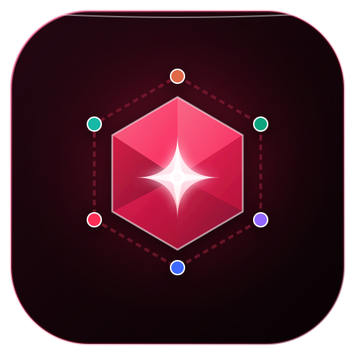

# Multi-Bot Arena • Scarlet Liquid Glass Edition

<p align="center">
  
</p>

<p align="center">
  <b>A unified desktop comparative arena embedding the world's leading AI chatbots into a single synchronized workspace.</b>
</p>

<p align="center">
  
  
  
  
</p>

---

## 🌟 Overview

**Multi-Bot Arena** consolidates separate desktop shortcuts and fragmented browser tabs into a single, high-performance desktop application. Run **Claude**, **DeepSeek**, **Gemini**, **ChatGPT**, **Grok**, and **Perplexity** side-by-side with your existing web accounts—retaining all native web capabilities (Canvas, Artifacts, DeepSeek-R1 reasoning steps, Google Drive integration, and Perplexity citation previews) with **zero API token costs**.

---

## ⚡ Key Capabilities

### 1. Unified Parallel Prompt Broadcasting
- Type your master prompt once and broadcast it across all active models simultaneously using `Promise.all` parallel dispatch.
- **Universal Framework Injection Engine**: Seamlessly triggers modern reactive inputs (React 18/19 `_valueTracker`, Vue 3, TipTap/ProseMirror, and Quill).
- Built-in latency benchmark timer tracking elapsed response times.

### 2. Isolated Persistent Sessions
- Each chatbot operates inside an isolated Chromium partition (`persist:claude`, `persist:chatgpt`, etc.).
- Log in once and stay authenticated across application restarts.
- **Google OAuth / Cloudflare Handshake Fix**: Custom header sanitization, Blink automation flag bypass (`disable-blink-features: AutomationControlled`), and native Chromium window popup management ensure login flows never fail with "insecure browser" blocks.

### 3. Dynamic Arena Layouts
- **Hexa Grid (2x3)** *(Default)*: All 6 models visible simultaneously.
- **Quad Grid (2x2)**: 4-way duel for deep generalist benchmarking.
- **Duel Split (1x2)**: Head-to-head comparison (e.g., Claude 3.5 Sonnet vs. DeepSeek-R1).
- **Focus (1x1)**: Single-model distraction-free view.
- **Tabs**: Tabbed navigation between models.

### 4. Per-Model Controls & Synchronized Scrolling
- **Zoom Engine**: Independent scaling (`＋` / `－`) from 40% to 250% per pane with native Chromium zoom and viewport fallback.
- **Synchronized Scrolling (`Sync Scroll`)**: Toggleable real-time scroll sync that mirrors scroll percentages across all active panes.
- **Pane Navigation**: Individual Reload, Reset to Home, Fullscreen Focus, and Open in System Browser buttons.

### 5. Response Extraction & Comparison Arena (`Alt + C`)
- Dedicated comparison modal extracting the latest assistant response from each model.
- Metrics display: Word counts and character counts.
- 1-click response copying to clipboard.
- **Export to Markdown**: Save your complete prompt-and-response comparative session into a structured `.md` file with one click.

### 6. Scarlet Liquid Glass Aesthetic
- Genuine optical lens blur powered by layered CSS backdrop filters (`blur(28px) saturate(210%) contrast(95%)`).
- Ambient animated crimson/scarlet liquid light orbs that illuminate translucent glass panels from behind.
- Specular chromatic highlights and rich obsidian-garnet surface contrast (`#090204`).
- Crisp SVG vector icon system replacing all informal emojis.

---

## 📁 Project Structure

```
e:\Aerial.Vue\TOOLS\bots\
├── main.js                     # Electron main process (OAuth popups, session headers, CSP/COOP bypass)
├── preload.js                  # IPC security bridge
├── webview-preload.js          # Webview preload masking automation flags & navigator.webdriver
├── index.html                  # Liquid Glass desktop shell
├── bot-config.js               # CommonJS bridge for Electron main process
├── arena.svg                   # Master vector icon
├── arena.png                   # High-resolution 512x512 raster icon
├── arena.ico                   # Windows multi-resolution icon (256, 128, 64, 48, 32, 16px)
├── start-arena.bat             # 1-click batch launcher
├── create-desktop-shortcut.ps1 # PowerShell script to install Windows Desktop shortcut
├── package.json                # Project dependencies and npm scripts
├── .gitignore                  # Production git ignore configuration
├── styles/
│   ├── theme.css               # Scarlet palette, ambient liquid light orbs, lens blur variables
│   ├── layout.css              # Titlebar, nav strip, CSS grid layouts, bottom dock
│   └── components.css          # Cards, buttons, inputs, modal drawer, checkboxes
└── src/
    ├── app.js                  # Central frontend orchestrator
    ├── config/
    │   └── bots.js             # Model registry, DOM injection & extraction scripts
    ├── services/
    │   ├── broadcast.js        # Parallel prompt broadcast & latency benchmark timer
    │   └── compare.js          # Response extraction, diffing & Markdown export
    └── components/
        ├── Icons.js            # SVG vector icon library (brands, layouts, actions)
        ├── Titlebar.js         # Window controls & layout switcher
        ├── BotNav.js           # Model pills, sync scroll, reload all, compare modal trigger
        ├── ArenaGrid.js        # Webview manager, zoom (+/-), reload, home, focus mode
        ├── PromptDock.js       # Master prompt dock, presets, history, status
        └── CompareModal.js     # Side-by-side extracted response comparison modal
```

---

## 🚀 Getting Started

### Prerequisites
- **Node.js**: v18.0.0 or higher
- **npm**: v9.0.0 or higher
- **OS**: Windows 10 / 11

### Quick Launch
Double-click [`start-arena.bat`](file:///e:/Aerial.Vue/TOOLS/bots/start-arena.bat) in the project root.

### Terminal Launch
```bash
# Navigate to project directory
cd e:\Aerial.Vue\TOOLS\bots

# Install dependencies (first time only)
npm install

# Start the application
npm start
```

### Install Desktop Shortcut
To place the **Multi-Bot Arena** shortcut directly onto your Windows desktop with the custom Scarlet icon:
```powershell
powershell -ExecutionPolicy Bypass -File .\create-desktop-shortcut.ps1
```
*(Or right-click `start-arena.bat` > **Send to** > **Desktop (create shortcut)**).*

---

## ⌨️ Keyboard Shortcuts

| Shortcut | Action |
| :--- | :--- |
| `Ctrl + Enter` | Broadcast master prompt to all selected models |
| `Alt + C` | Open the **Response Comparison Arena** modal |
| `Alt + 6` | Switch to **Hexa Grid (2x3)** *(Default)* |
| `Alt + 4` | Switch to **Quad Grid (2x2)** |
| `Alt + 2` | Switch to **Duel Split (1x2)** |
| `Alt + 1` | Switch to **Single Bot Focus (1x1)** |
| `Ctrl + R` | Hot-reload application interface |
| `ArrowUp` / `ArrowDown` | Navigate prompt history in the master prompt bar |

---

## 🛠️ Technical Details & Security Bypasses

### 1. Google OAuth & Anti-Bot Protection
Google Sign-in and Cloudflare block embedded Chromium frames by inspecting `navigator.webdriver` and Client Hints (`sec-ch-ua`). Multi-Bot Arena handles this by:
- Launching with `disable-blink-features: AutomationControlled`.
- Injected `webview-preload.js` removing `navigator.webdriver` and emulating standard `window.chrome` runtime objects.
- Dynamically routing `accounts.google.com` requests through a desktop Firefox User-Agent without `sec-ch-ua` headers, avoiding Chromium-specific authentication blocks.

### 2. Preserved Popup Opener Linkage
Popup windows (such as "Sign in with Google" or "Sign in with Apple") use Electron's native window open handler (`action: 'allow'`) sharing the partition session. This preserves `window.opener` so post-login callback tokens complete smoothly.

### 3. Framework-Agnostic Reactive Dispatch
Modern web apps like DeepSeek, Grok, and Perplexity use React 18/19 or Vue 3. When setting input values programmatically, standard DOM `.value = '...'` assignments are ignored by internal value trackers. The injector invokes the prototype setter (`HTMLTextAreaElement.prototype.value.set`), resets `_valueTracker.setValue('')`, and dispatches full `beforeinput`, `input`, and `change` event sequences.

---

## 📄 License

MIT License. Designed and engineered for high-productivity AI research and comparative benchmarking.
